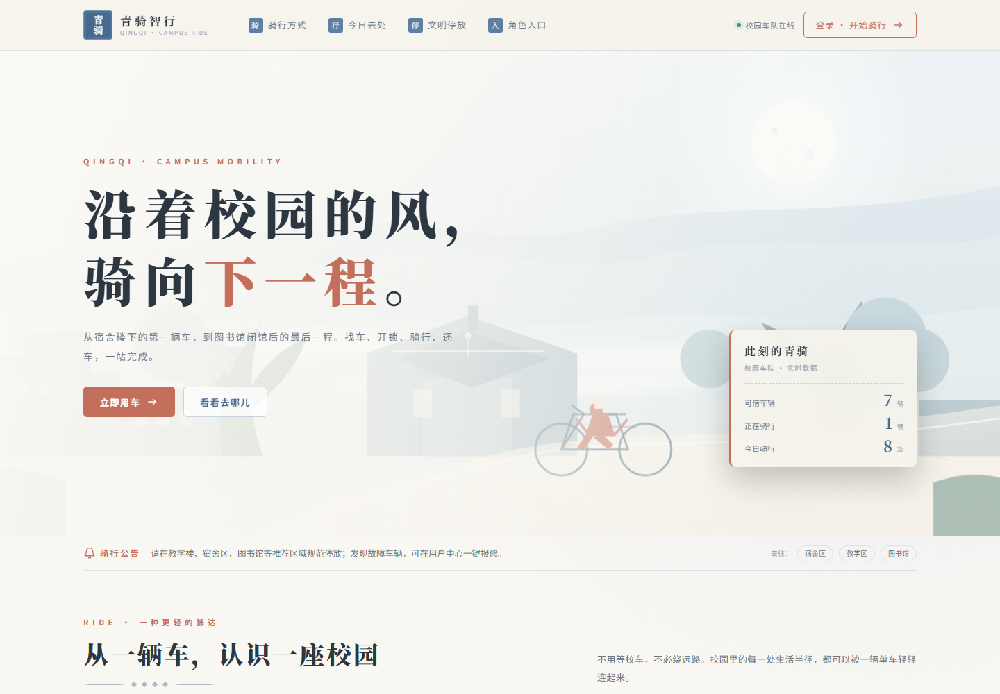
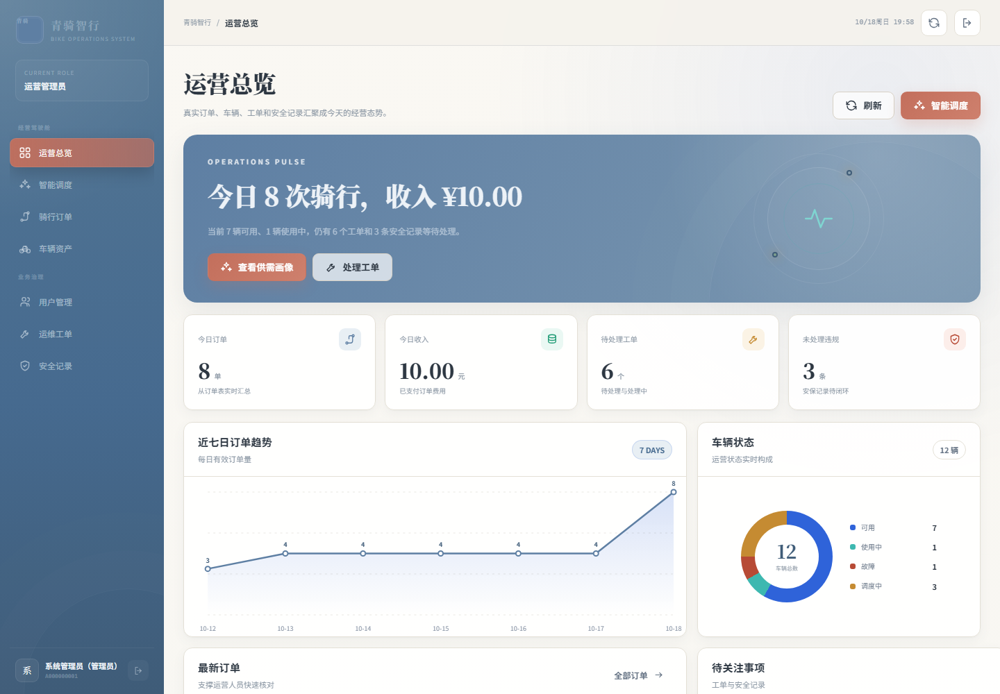
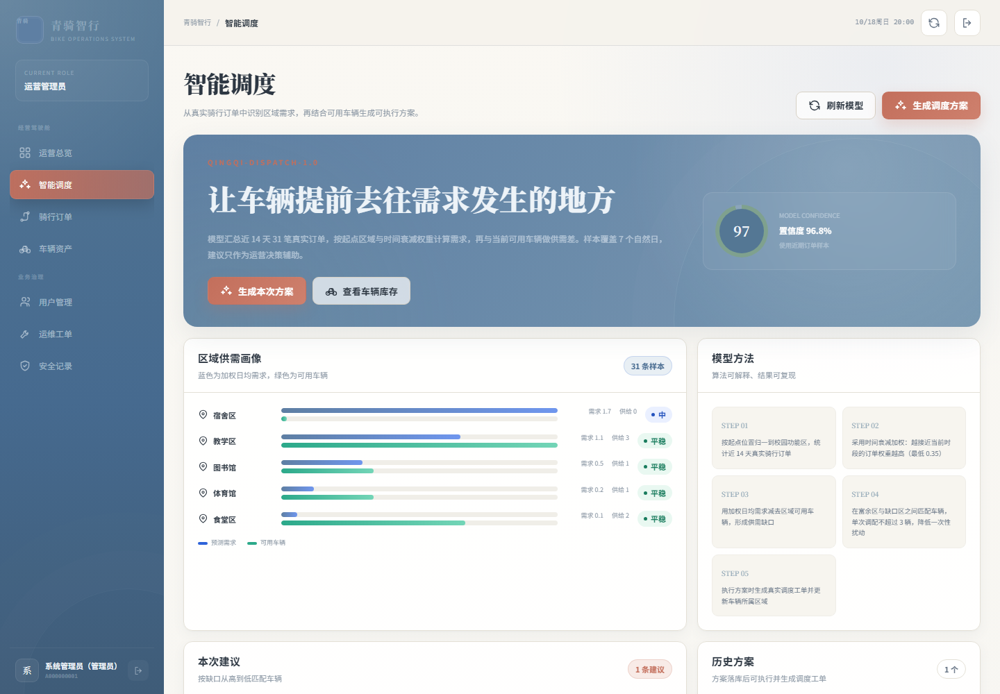
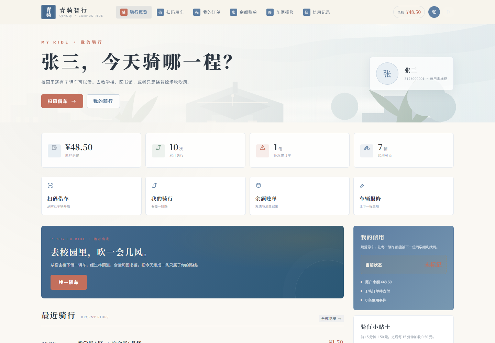
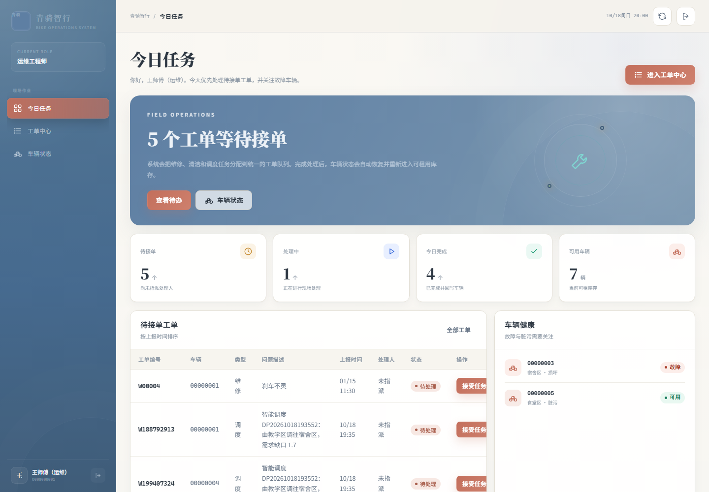
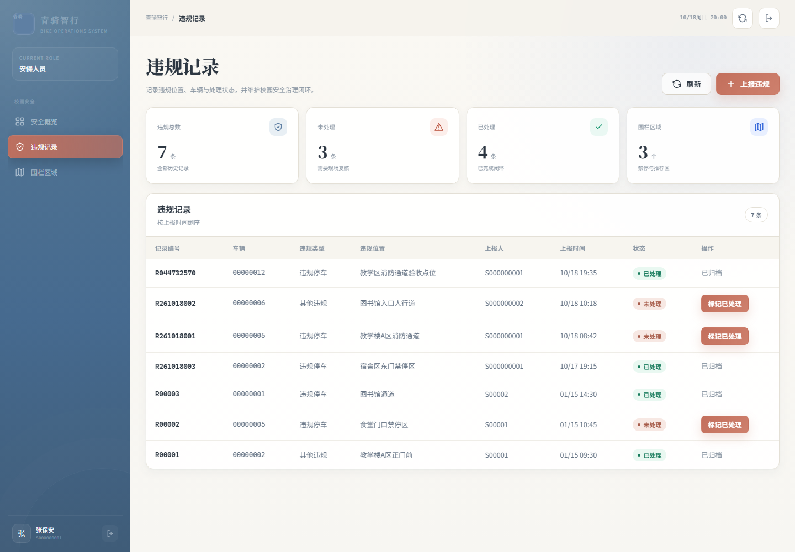

# 校园共享单车管理系统

基于 Java 17、Spring Boot 3.5、Spring Data JPA 和 MySQL 的校园共享单车管理系统。项目包含用户、管理员、运维人员和安全人员四类入口，覆盖骑行和运营流程。

## 功能

- 用户端：登录、查看车辆、开始和结束骑行、订单记录、余额与账单。
- 管理端：车辆、用户、围栏规则、维修工单和业务数据概览。
- 运维端：车辆调度、维修处理和运营数据。
- 安全端：违规记录、安全人员和相关业务数据。
- 调度模块：根据车辆状态和区域生成调度计划。
- 数据库兼容：启动时执行幂等结构升级，不重建或清空业务表。

## 页面截图

| 用户首页 | 管理概览 |
| --- | --- |
|  |  |

| 调度计划 | 用户控制台 |
| --- | --- |
|  |  |

| 运维控制台 | 安全记录 |
| --- | --- |
|  |  |

## 技术栈

- Java 17
- Spring Boot 3.5
- Spring Data JPA
- MySQL
- HTML / CSS / JavaScript
- Maven

## 本地运行

1. 在 MySQL 中创建数据库 `suc`。
2. 设置数据库环境变量：

   ```powershell
   $env:BIKE_DB_URL="jdbc:mysql://localhost:3306/suc?useSSL=false&serverTimezone=Asia/Shanghai&characterEncoding=utf8&allowPublicKeyRetrieval=true"
   $env:BIKE_DB_USERNAME="root"
   $env:BIKE_DB_PASSWORD="你的数据库密码"
   ```

3. 可选：导入演示数据：

   ```powershell
   mysql -u root -p suc < scripts/seed_demo_20261018.sql
   ```

4. 启动项目：

   ```powershell
   .\mvnw.cmd spring-boot:run
   ```

5. 访问 <http://localhost:8080>。

数据库密码通过 `BIKE_DB_PASSWORD` 环境变量传入，不保存在仓库配置中。

## 构建

```powershell
.\mvnw.cmd -DskipTests package
```

## 目录结构

```text
src/main/java/com/cjy/bikesystem/
├── config/       # 数据库结构升级
├── controller/   # REST 接口和页面入口
├── entity/       # 数据实体
├── exception/    # 业务异常和统一响应
├── repository/   # JPA 数据访问
├── service/      # 业务逻辑、调度和统计
└── web/dto/      # 请求数据结构

src/main/resources/
├── application.properties
└── static/       # 各角色页面、样式和交互脚本

src/test/         # 服务和应用的测试代码
scripts/          # 演示数据
tools/            # 页面截图工具
docs/screenshots/ # 项目页面截图
```

## 部署说明

项目源码位于个人主页仓库的 `projects/bike-system` 目录。GitHub Pages 只能托管静态页面，完整的 Spring Boot 和 MySQL 应用需要部署到支持 Java 的运行环境。
